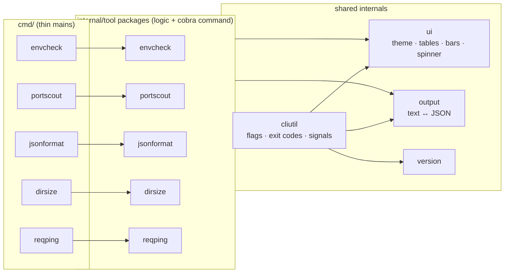

<div align="center">

# go-cli-tools

**Five small, fast command-line tools for everyday dev workflows — single binaries, zero setup, CI-friendly.**

[](https://github.com/tonklasocute/go-cli-tools/actions/workflows/ci.yml)
[](https://pkg.go.dev/github.com/tonklasocute/go-cli-tools)
[](https://goreportcard.com/report/github.com/tonklasocute/go-cli-tools)
[](https://github.com/tonklasocute/go-cli-tools/releases)
[](LICENSE)


</div>

| Tool | What it does |
|------|--------------|
| [`envcheck`](#envcheck) | Validate `.env` files against an annotated `.env.example` schema |
| [`portscout`](#portscout) | Fast concurrent TCP port scanner with dev-service names |
| [`jsonformat`](#jsonformat) | Pretty-print, minify, query and validate JSON — with errors that point at the exact character |
| [`dirsize`](#dirsize) | Concurrent directory size analyzer with a terminal bar chart |
| [`reqping`](#reqping) | HTTP health checker with latency stats, TLS expiry and watch mode |

Every tool speaks the same language: `--help` with examples, `--version`, `--json` for scripts,
`--no-color` (and [`NO_COLOR`](https://no-color.org)), colors only on a real terminal, stdin support,
and [predictable exit codes](#exit-codes).

## Install

**With Go 1.22+**

```sh
go install github.com/tonklasocute/go-cli-tools/cmd/envcheck@latest
go install github.com/tonklasocute/go-cli-tools/cmd/portscout@latest
go install github.com/tonklasocute/go-cli-tools/cmd/jsonformat@latest
go install github.com/tonklasocute/go-cli-tools/cmd/dirsize@latest
go install github.com/tonklasocute/go-cli-tools/cmd/reqping@latest
```

**Prebuilt binaries** for Linux, macOS and Windows (amd64 and arm64) are attached to every
[release](https://github.com/tonklasocute/go-cli-tools/releases) — download the archive for your platform,
verify it against `checksums.txt`, and put the binaries on your `PATH`.

**From source**

```sh
git clone https://github.com/tonklasocute/go-cli-tools.git
cd go-cli-tools
make install        # or: make build  → ./bin/
```

---

## envcheck

**Catch broken config before your app does.** Your `.env.example` already lists every key — add a short
comment with rules and `envcheck` turns it into a schema. It reports missing keys, type errors, typos in
enums, unknown and duplicate keys, and malformed lines with line numbers. Values marked `secret` are never
printed, not even in `--json`.


```sh
envcheck                                          # .env vs .env.example in the current dir
envcheck --env .env.production --strict           # warnings fail too (great for CI)
cat .env | envcheck --env - --json                # read from stdin, machine-readable output
envcheck init > .env.example                      # bootstrap a schema from an existing .env
```

Schema (`.env.example`):

```dotenv
PORT=3000                # required,int,min=1,max=65535
DATABASE_URL=            # required,url,secret
LOG_LEVEL=info           # enum=debug|info|warn|error
DEBUG=false              # bool
ADMIN_EMAIL=             # email
API_KEY=                 # required,secret,regex=^ak_(live|test)_[A-Za-z0-9]{24,}$
```

Rules: `required`, `secret`, `int`, `float`, `bool`, `url`, `email`, `enum=a|b`, `regex=<pattern>` (last), `min=N`, `max=N`.

```text
$ envcheck --env docs/samples/.env --schema docs/samples/.env.example
KEY              STATUS   MESSAGE
───────────────  ───────  ──────────────────────────────────────────────────────────
APP_NAME         ✔ ok     length 3–32
PORT             ✘ error  "70000" is above the maximum 65535 (line 3)
HOST             ✔ ok     string
LOG_LEVEL        ✘ error  "verbose" is not one of debug|info|warn|error (line 5)
DEBUG            ✔ ok     bool
REQUEST_TIMEOUT  ✔ ok     float 0.1–60
DATABASE_URL     ✔ ok     url, secret
REDIS_URL        • skip   optional, not set
DB_POOL_SIZE     ✔ ok     int 1–100
DB_POOL_SIZE     ▲ warn   duplicate key on lines 10, 17; the last one (line 17) wins
API_KEY          ✔ ok     matches ^ak_(live|test)_[A-Za-z0-9]{24,}$, secret
JWT_SECRET       ✘ error  required but not set
ADMIN_EMAIL      ✘ error  "ops@@example.com" is not a valid email address (line 12)
RELEASE          ✔ ok     matches ^v\d+\.\d+\.\d+(-[0-9A-Za-z.]+)?$
FEATURE_FLAGS    ▲ warn   not declared in the schema (line 16)

✘ 4 errors, 2 warnings, 8 ok, 1 skipped — docs/samples/.env vs docs/samples/.env.example
```

The parser handles comments, `export` prefixes, single/double quotes, escapes, multiline quoted values,
CRLF and BOMs. Variable expansion (`${VAR}`) is intentionally not performed.

---

## portscout

**"Is Postgres actually up?"** — answered in milliseconds. A concurrent TCP connect scanner with a curated
list of common dev ports (Vite, Postgres, Redis, Mongo, Elasticsearch, …), service names, latency, a
progress bar and clean Ctrl+C handling that still prints partial results.

> **Ethical use:** only scan hosts you own or are explicitly authorized to test.


```sh
portscout                                          # common dev ports on localhost
portscout db.internal -p 5432,6379                 # specific ports on another host you own
portscout -p 1-1024,3306,8000-9000 --workers 500   # ranges and lists
portscout --expect-open 5432 --timeout 2s && make migrate   # CI: wait-for-db style gate
```

```text
$ portscout -p 3000,3306,5173,5432,6379,8080,9200,27017
Scanning localhost (127.0.0.1) — 8 ports, 8 workers, timeout 500ms

 PORT  STATE   SERVICE        LATENCY
─────  ──────  ─────────────  ───────
 3000  closed  dev-server       517µs
 3306  closed  mysql            517µs
 5173  open    vite             549µs
 5432  open    postgres         549µs
 6379  open    redis            549µs
 8080  open    http-proxy       549µs
 9200  closed  elasticsearch    549µs
27017  closed  mongodb          549µs

4 open, 4 closed in 1.1ms

$ portscout --expect-open 5432,27017
...
✘ expected open but not: 27017 (closed)        # exit code 1
```

Scans of more than 100 ports list only open ports by default (`--open-only=false` to show everything).

---

## jsonformat

**A JSON formatter whose errors you can actually read.** Instead of
`invalid character '"' after object key:value pair`, you get the file, line and column, the surrounding
lines, a caret under the offending character, and a hint.


```sh
jsonformat data.json                     # pretty-print with syntax highlighting
curl -s https://api.example.com | jsonformat --sort-keys
jsonformat --check config/*.json         # validate only; exit 1 if any file is invalid
jsonformat -w --indent 4 package.json    # rewrite in place (atomically)
jsonformat -q 'tools[0].tags' data.json  # extract a value; add -r for raw strings
```

```text
$ jsonformat docs/samples/broken.json
docs/samples/broken.json:8:5: error: expected ',' or '}' after object value, found '"'
    6 |     "user": "billing",
    7 |     "pool_size": 20
    8 |     "timeout": "5s"
      |     ^
  hint: is a ',' missing at the end of line 7?

$ echo '{"a": [1, 2,]}' | jsonformat
<stdin>:1:12: error: trailing comma before ']'
    1 | {"a": [1, 2,]}
      |            ^
  hint: JSON does not allow trailing commas

$ jsonformat -q 'maintainers[0].name' -r docs/samples/data.json
Ada
```

Pretty-printing and minifying stream through a strict RFC 8259 scanner, so memory stays flat on large
files, and numbers are copied verbatim — `12345678901234567890` and `1.000000000000000000001` survive
unchanged. NDJSON / concatenated values are supported.

---

## dirsize

**Find out where the disk space went.** A concurrent directory walker that shows sizes, percentages, file
counts and a bar chart — and skips what it can't read instead of giving up.


```sh
dirsize                                            # top 10 entries in the current dir
dirsize ~/projects --depth 2 --exclude node_modules,.git
dirsize --files --top 20 --min-size 50MB           # largest individual files
dirsize /var/log --json | jq '.entries[0]'
```

```text
$ dirsize --depth 2        # inside the Go toolchain directory
dirsize ./ — depth 2 · top 10

      SIZE      %                            FILES  NAME
  ────────  ─────  ────────────────────────  ─────  ───────────────
  66.8 MiB  29.7%  ███████▏░░░░░░░░░░░░░░░░      8  pkg/tool/
  48.9 MiB  21.8%  █████▎░░░░░░░░░░░░░░░░░░  4,347  src/cmd/
  15.4 MiB   6.8%  █▋░░░░░░░░░░░░░░░░░░░░░░  1,209  src/runtime/
  15.1 MiB   6.7%  █▋░░░░░░░░░░░░░░░░░░░░░░         bin/go.exe
  11.7 MiB   5.2%  █▎░░░░░░░░░░░░░░░░░░░░░░  1,166  src/crypto/
   7.7 MiB   3.4%  ▉░░░░░░░░░░░░░░░░░░░░░░░  1,333  src/internal/
   5.3 MiB   2.4%  ▋░░░░░░░░░░░░░░░░░░░░░░░    354  src/syscall/
   5.3 MiB   2.4%  ▋░░░░░░░░░░░░░░░░░░░░░░░    165  src/vendor/
   5.2 MiB   2.3%  ▌░░░░░░░░░░░░░░░░░░░░░░░  2,294  test/fixedbugs/
   3.7 MiB   1.7%  ▍░░░░░░░░░░░░░░░░░░░░░░░    415  src/net/
  39.6 MiB  17.6%                                   … and 511 more

  Total 225 MiB in 15,009 files, 1,666 dirs · scanned in 23ms
```

Symlinks are never followed; hard links are counted once on Linux/macOS (by device + inode; Windows
counts each link). Permission errors are counted and listed (fully in `--json`) without failing the scan.

---

## reqping

**A health check you can drop into CI or leave running on a second monitor.** Check many URLs
concurrently, assert status codes and body content, see latency and how many days are left on each TLS
certificate.


```sh
reqping https://go.dev https://github.com
reqping -f targets.txt --count 5                 # min / avg / p95 / max latency
reqping https://api.example.com/health --contains '"status":"ok"' -H "Authorization: Bearer $TOKEN"
reqping -f targets.txt --watch 10s               # live-refreshing table until Ctrl+C
```

Targets file — plain text, one `[name] url [expected_status]` per line:

```text
go-dev      https://go.dev
pkg-go-dev  https://pkg.go.dev                2xx
github      https://github.com                200
missing     https://go.dev/this-page-does-not-exist   200
```

```text
$ reqping -f docs/samples/targets.txt
NAME        STATUS  LATENCY  TLS  NOTE
──────────  ──────  ───────  ───  ─────────────────────
go-dev      ✔ 200     338ms  62d
pkg-go-dev  ✔ 200     322ms  35d
github      ✔ 200     149ms  42d
go-proxy    ✔ 200     162ms  64d
missing     ✘ 404     336ms  62d  expected 200, got 404
✔ 4 healthy, ✘ 1 unhealthy · 449ms

$ reqping -f docs/samples/targets.txt --count 3
NAME        STATUS   OK    MIN    AVG    P95    MAX  TLS  NOTE
──────────  ──────  ───  ─────  ─────  ─────  ─────  ───  ─────────────────────
go-dev      ✔ 200   3/3  237ms  309ms  372ms  372ms  62d
pkg-go-dev  ✔ 200   3/3  252ms  266ms  287ms  287ms  35d
github      ✔ 200   3/3   51ms   83ms  138ms  138ms  42d
go-proxy    ✔ 200   3/3  6.1ms   27ms   65ms   65ms  64d
missing     ✘ 404   0/3  246ms  323ms  397ms  397ms  62d  expected 200, got 404
✔ 4 healthy, ✘ 1 unhealthy · 1.18s
```

Certificates expiring in under 14 days are flagged `▲`. Any unhealthy target makes `reqping` exit `1`.

---

## Why I built this

I'm a developer from Bangkok, and most of my day is small, repetitive checks: is the `.env` right, is the
database container listening yet, which JSON file has the stray comma, what is eating my disk, is staging
up. I kept writing one-off scripts for these, so I turned them into proper tools — fast, single binaries
that behave the same way and work just as well in a terminal as in a CI pipeline. They were also a good
excuse to write Go the way I like it: small packages, real tests, no magic.

## Architecture

```text
go-cli-tools/
├── cmd/<tool>/main.go        # one line: os.Exit(cliutil.Main(<tool>.NewCommand))
├── internal/
│   ├── envcheck/             # dotenv + schema parsers, validator, init generator, cli.go
│   ├── portscout/            # port specs, service table, worker-pool scanner, cli.go
│   ├── jsonformat/           # streaming scanner, emitter/highlighter, error snippets, query, cli.go
│   ├── dirsize/              # concurrent walker, hard-link dedupe, report, bar chart, cli.go
│   ├── reqping/              # targets parser, checker, TLS expiry, stats, watch loop, cli.go
│   ├── cliutil/              # shared flags, exit codes, error reporting, Ctrl+C handling
│   ├── ui/                   # theme/NO_COLOR/TTY detection, tables, bars, spinner, sizes, durations
│   ├── output/               # text vs --json switch
│   ├── version/              # version info via -ldflags (falls back to Go build info)
│   └── testutil/             # build-and-run helpers for integration tests
├── docs/                     # demo GIFs, VHS tapes, sample data
├── .github/workflows/        # CI (lint + 3 OS × 2 Go versions) and GoReleaser release
├── Makefile
└── .goreleaser.yaml
```



Design notes:

- **`cmd/` is a single line.** Each tool's cobra command is built in `internal/<tool>/cli.go` against an
  injectable `IO` (stdin/stdout/stderr), so the CLI is tested in-process — exit codes, `--json` shape,
  help text — and every tool also has an integration test that builds and runs the real binary.
- **Two dependencies:** [cobra](https://github.com/spf13/cobra) for the CLI and
  [lipgloss](https://github.com/charmbracelet/lipgloss) for styling. Everything else is the standard library.
- **Concurrency is always bounded** — fixed worker pools for ports, URLs and directories — and every
  long-running operation honours context cancellation, so Ctrl+C stops promptly and still reports partial results.
- **Output is for both humans and machines.** Progress indicators go to stderr only when it's a terminal;
  stdout stays clean for pipes, and `--json` gives a stable, documented shape.

## Benchmarks

Measured with `make bench` on an Intel Core i7-10700 (8 cores / 16 threads). Linux numbers come from the
`golang:1.22` container on the same machine.

**dirsize** — scanning a generated tree of 20,000 files in 1,110 directories:

| Walker | Linux | Windows 11 |
|---|---:|---:|
| `filepath.WalkDir` (baseline, sequential) | 58.2 ms · 343k files/s | 81.9 ms · 244k files/s |
| dirsize, 1 worker | 53.2 ms · 376k files/s | 72.5 ms · 276k files/s |
| dirsize, 4 workers | 16.0 ms · 1.25M files/s | 21.9 ms · 914k files/s |
| dirsize, 16 workers | **12.9 ms · 1.56M files/s** | 16.5 ms · 1.21M files/s |
| dirsize, 64 workers | 15.6 ms · 1.28M files/s | **13.6 ms · 1.47M files/s** |

**portscout** — 200 ports through a simulated network with 1 ms connect latency (shows worker-pool
scaling independent of the OS network stack), plus a real scan of 20 local listeners (Linux):

| Workers | 200 simulated ports | 20 real local ports |
|---:|---:|---:|
| 1 | 229 ms | 1.96 ms |
| 10 | 23.1 ms | — |
| 20 | — | 0.67 ms |
| 100 | 2.77 ms | — |
| 500 (capped at 200) | 1.59 ms | — |

**jsonformat** — a generated ~10 MB document (Windows 11): pretty 85 MB/s · minify 93 MB/s ·
sort-keys 45 MB/s · validate (`--check`) 187 MB/s.

## Exit codes

All tools share the same convention, so they compose well in shell scripts and CI:

| Code | Meaning | Examples |
|---:|---|---|
| `0` | Success, every check passed | valid `.env`, all URLs healthy |
| `1` | Ran fine, but a check failed | schema violation, invalid JSON, `--query` path not found, unhealthy URL, `--expect-open` port down |
| `2` | Usage or operational error | unknown flag, bad port spec, unreadable file, invalid schema |
| `130` | Interrupted with Ctrl+C | partial results are still printed where it makes sense |

## Development

```sh
make build      # binaries in ./bin
make test       # unit + integration tests
make race       # with the race detector (needs cgo)
make cover      # coverage summary, fails below 80%
make lint       # golangci-lint
make bench      # dirsize + portscout benchmarks
make demo       # re-render docs/demo/*.gif with VHS
```

## Contributing

Issues and pull requests are welcome — see [CONTRIBUTING.md](CONTRIBUTING.md). Commits follow
[Conventional Commits](https://www.conventionalcommits.org), which also drive the release changelog.

## License

[MIT](LICENSE) © Khomkrit Daengnuan
